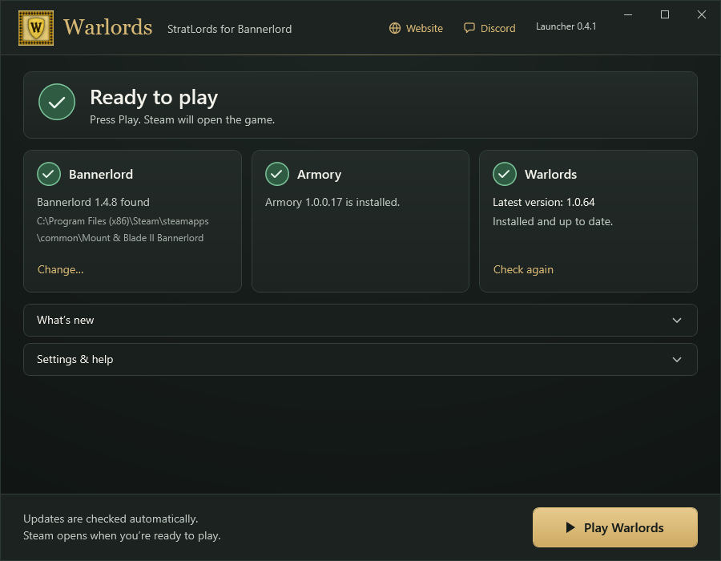

# Warlords launcher

Warlords.exe is a small Windows app. It installs the StratLords mod for
Mount & Blade II: Bannerlord and keeps it up to date. That is all it does.

**[Download Warlords.exe](https://github.com/extelonlabs/warlords-launcher/releases/latest/download/Warlords.exe)**
(free, open source, MIT license)



## Is it safe?

Yes. You do not have to trust us. You can check it yourself:

- **Virus scan:** [VirusTotal scan of Warlords.exe 0.5.1](https://www.virustotal.com/gui/file/a343ec504ba67743c880d76a1226107755cfa275f89429be3ffea38f91f6edc1).
  VirusTotal checks a file with dozens of antivirus programs at once.
- **Same file:** in PowerShell, run `Get-FileHash .\Warlords.exe`.
  For launcher 0.5.1 it must show
  `A343EC504BA67743C880D76A1226107755CFA275F89429BE3FFEA38F91F6EDC1`.
  This is the file's fingerprint. It is the same one VirusTotal scanned, and the
  release page lists it in `SHA256SUMS.txt`.
- **Open code:** every line of the app is in [src/Warlords.Launcher](src/Warlords.Launcher).
  Anyone can read it or build it.

**It is not a hacking or cheat tool.** It does not:

- change the game's program files, Native, Armory or any other mod
- read your Steam login or passwords
- skip Steam or TaleWorlds sign-in, or server rules
- ask for admin rights
- upload your files or data anywhere

What it does:

- downloads only, over HTTPS, from GitHub
- writes only the StratLords mod (plus a backup of the old copy) in your
  Bannerlord folder, and its own settings in `%LOCALAPPDATA%\WarlordsLauncherV2`
- reads the Windows registry only to find where Steam is installed and to check
  that .NET Framework 4.8 is there
- asks Steam to start the game when you press Play

### Windows says "Windows protected your PC"

The app is not code-signed yet. (Code signing is a paid certificate that tells
Windows who made a file.) So Windows may warn you the first time. Click
**More info**, then **Run anyway**.

## How it works

You need Windows 10 or 11 (64-bit) and Bannerlord **1.5.7** on Steam. Windows
normally has .NET Framework 4.8 already. If yours does not, the launcher tells
you and opens Microsoft's download page.

1. **Download** `Warlords.exe` and double-click it. There is nothing to install.
2. **Bannerlord:** it finds your game folder by itself. If it picks the wrong
   one, click **Change…** and choose it.
3. **Armory:** it checks for Warlords Armory **1.0.0.17**. If it is missing, click
   **Get Armory** and subscribe on the
   [Steam Workshop](https://steamcommunity.com/sharedfiles/filedetails/?id=3712562953).
4. **Warlords:** click **Install Warlords**. It downloads the mod, checks the
   fingerprint of every file, and installs it. If a check fails, it stops and
   installs nothing.
5. **Play:** click **Play Warlords**. Steam opens the game.

After that, it checks for updates each time you open it and again before you
play. The newest notes show on the main screen, and **Read all** opens the full
list. **Settings & help** has **Verify files**, **Reinstall / repair** and
**Open logs**.

## Build it yourself

With the **.NET 10 SDK** on Windows, run this from the repository root:

```powershell
./src/Warlords.Launcher/Build.ps1
```

You get `artifacts/launcher/Warlords.exe`. No game files, private code or
passwords are needed.

## More

- [SECURITY.md](SECURITY.md): known limits, and how to report a problem privately.
- [SOURCE-EXPORT.md](SOURCE-EXPORT.md): what this repository contains.
- The MIT license covers the launcher code only. The game, the mods, and the
  Warlords name, logo and artwork keep their own rights. See the
  [branding notice](src/Warlords.Launcher/Assets/NOTICE.md).
